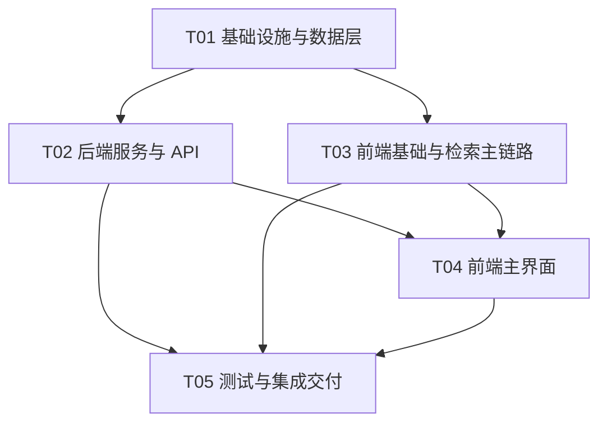

# TagVault 系统架构设计与任务分解

> 依据《标签管家（TagVault）需求规格说明书 v1.2》（见 `docs/SRS.md`）设计。
> 语言：中文。设计原则：简单、模块化、可测试、完全离线。

---

## Part A：系统设计

### 1. 实现方案

#### 1.1 核心技术难点与对策

| 难点 | 对策 |
|---|---|
| 中文子串"输入即搜"（≤200ms / 万级） | SQLite **FTS5 trigram tokenizer** 支持任意 ≥3 字符子串 MATCH；<3 字符（或含 CJK 单/双字）自动降级为 `LIKE '%kw%'` + 索引列。全文索引由**触发器**与业务表实时同步，打标即搜（TAG-4） |
| 文件原地不动、显式索引 | 后端只读 `fs.stat`；唯一写操作是工具自己的 SQLite/缩略图目录。chokidar 只监听用户添加的目录（IDX-6） |
| 单文件可搬运存储 | 一个 `tagvault.db`（含 FTS5）；`thumbs/` 缓存与 config.json 同目录；缩略图 URL 带 `?v=<mtime>` 内容版本号防串图（OP-6） |
| 字段化检索 `类型:值`（SR-8） | 独立解析器 `query-parser.js`：全角冒号归一 → 按当前标签类型名白名单切分 → `\|`=或、空格=且；非类型名前缀退化为普通关键词；解析结果与面板筛选合并后走同一 SQL 构建 |
| 组合筛选语义（同类型=或，跨类型=且） | SQL 构建：每个标签类型生成一个 `EXISTS (SELECT 1 FROM tags WHERE file_id=f.id AND type_id=? AND value IN (...))` 子查询，子查询之间 AND（SR-2） |
| 枚举白名单（OPEN-2） | 后端打标时校验：`input_mode='enum'` 的类型，value 必须存在于 tag_values，否则 422 |
| 字典值长度（OPEN-3） | 后端统一校验 value ≤ 100 字符，前端同步限制 |
| 文件夹选择框慢（OPEN-1） | 常驻 PowerShell 宿主进程（启动时预热 WinForms `FolderBrowserDialog`，TopMost），首次调用 ~几百 ms；宿主异常时 COM（Shell.Application）兜底；手输路径永远可用 |
| 万级扫描入库 | 递归扫描 + 事务分批（每 500 条一个事务）写库；进度通过 SSE 实时推送 `n/N`（IDX-2） |
| 缩略图性能 | sharp 生成 256px webp，落盘缓存按 `sha1(路径+mtime)` 命名；文件变更（watcher）后 mtime 变化 → URL 变 → 缓存自动失效重生成 |
| 交付形态一条命令 | `npm start` = Node 直接启动 Express，托管已构建的 `dist/` 并自动开浏览器；开发模式 `npm run dev` 用 Vite 代理 |

#### 1.2 框架选型与理由

- **后端：Node.js 20+ / Express 4**（SRS 指定）：单进程即可承载扫描、监听、缩略图、PowerShell 宿主；`better-sqlite3` 同步 API 简单可靠，Node 20 LTS 有官方 prebuilt，Windows 免编译。
- **全文索引：better-sqlite3 内置 FTS5 + trigram tokenizer + 触发器同步**：零额外服务，满足"单文件 SQLite"硬性原则。
- **文件监听：chokidar@3**：Windows 稳定、API 简单，支持 add/unlink/change/rename 事件。
- **缩略图：sharp@0.33**：有 Windows prebuilt，webp 输出小且快。
- **前端：React 18 + Vite 5 + TypeScript**：SRS 指定 React18+Vite；TS 提升契约一致性。虚拟滚动用 `@tanstack/react-virtual`（表格与网格同用）；状态用 `zustand`（轻量、无 Provider 样板）；样式用 **Tailwind CSS**（避免引大型组件库，保持离线小体积、三栏布局自由度高）。
- **测试：Vitest + Supertest**：API 级测试直起 Express app 实例打临时 SQLite 库（OPEN-4）；`query-parser` 纯函数单测。
- **架构模式**：分层架构（路由层 routes → 服务层 services → 数据层 db），前端单向数据流（store → 组件 → api → store）。

#### 1.3 进程与通信

- Express 进程内含：SQLite 连接、扫描器、chokidar watcher、缩略图生成器、PowerShell 宿主管理器。
- 前后端实时通道：**SSE（`GET /api/events`）** 推送扫描进度、watcher 变更、库变更事件；简单、离线、无依赖。

---

### 2. 文件列表

```
TagVault/
├── package.json                  # 依赖与 scripts（start/build/dev/test）
├── vite.config.ts                # Vite 配置（dev 代理 /api → 48765，build 出 dist/）
├── tsconfig.json                 # TS 配置（前端）
├── tailwind.config.js            # Tailwind 配置
├── postcss.config.js
├── index.html                    # Vite 入口 HTML
├── config.json                   # 运行时配置（首次启动自动生成）：端口/库路径
├── README.md                     # 启动说明
├── server/
│   ├── index.ts                  # Express 入口：静态托管 dist/、挂路由、SSE、自动开浏览器
│   ├── config.ts                 # config.json 读写（端口、数据目录）
│   ├── db.ts                     # better-sqlite3 连接 + schema 初始化 + 预设类型/未分类种子
│   ├── schema.sql                # 全部建表 SQL（含 FTS5 与触发器）
│   ├── events.ts                 # SSE 广播中心（扫描进度/watcher 变更）
│   ├── query-parser.ts           # `类型:值` 字段化检索解析器（纯函数）
│   ├── search-sql.ts             # 搜索 SQL 构建器（FTS/LIKE 降级 + 组合筛选 + 排序分页）
│   ├── routes/
│   │   ├── config.ts             # GET/PUT /api/config、GET /api/status
│   │   ├── directories.ts        # 目录增删查/重扫
│   │   ├── search.ts             # 搜索、facets、suggest、文件详情
│   │   ├── tags.ts               # 打标/去标/批量/快速添加
│   │   ├── tagTypes.ts           # 标签类型 + 字典值（改名/排序/显隐/移动/删除影响数）
│   │   ├── data.ts               # 导入导出、缺失检查/清理
│   │   └── system.ts             # pick-folder / open / reveal / 缩略图
│   └── services/
│       ├── scanner.ts            # 递归扫描 + 批量事务入库 + 进度上报 + 类型归类
│       ├── watcher.ts            # chokidar 监听已索引目录，≤10s 同步
│       ├── thumbnails.ts         # sharp 缩略图生成 + 内容版本缓存
│       ├── folderPicker.ts       # PowerShell 常驻宿主（WinForms 预热）+ COM 兜底
│       ├── shell.ts              # 用系统默认程序打开文件 / 打开所在文件夹
│       ├── tags-service.ts       # 打标幂等、枚举白名单校验、未分类归组、FTS 同步
│       ├── suggest.ts            # 快速添加跨类型前缀匹配 + 次数统计
│       └── transfer.ts           # JSON/CSV 导出、JSON 按类型名对齐导入
├── src/                          # 前端（React 18 + TS）
│   ├── main.tsx
│   ├── App.tsx                   # 三栏布局 + 独立滚动 + SSE 订阅
│   ├── api.ts                    # fetch 封装（统一 {code,data,message}）
│   ├── types.ts                  # 与后端契约对齐的类型定义
│   ├── store.ts                  # zustand：搜索词/筛选/排序/视图/选中/设置弹窗
│   ├── hooks/
│   │   ├── useDebounce.ts        # 150ms 输入防抖
│   │   └── useSSE.ts             # 扫描进度/文件变更事件
│   └── components/
│       ├── TopBar.tsx            # 标题/搜索框/排序/视图切换/结果数/已选 chips/全部清除
│       ├── FilterPanel.tsx       # 左栏：文件类型分组 + 各标签类型分组（可折叠、清空）
│       ├── FileTable.tsx         # 表格视图（@tanstack/react-virtual 虚拟化）
│       ├── ThumbGrid.tsx         # 缩略图网格（懒加载、可视区生成）
│       ├── DetailPanel.tsx       # 右栏：预览图/内容说明置顶/当前标签/按类型打标
│       ├── QuickTagInput.tsx     # 快速添加输入框 + 实时匹配提示下拉
│       ├── BatchTagBar.tsx       # 多选后批量打标/去标工具条
│       ├── ContextMenu.tsx       # 右键菜单（打开/所在文件夹/复制路径/编辑标签）
│       ├── MissingBadge.tsx      # 缺失文件醒目标识（OPEN-5）
│       └── SettingsDialog.tsx    # 设置弹窗（数据端口/索引目录/标签类型管理/导入导出/缺失清理）
├── tests/
│   ├── setup.ts                  # 临时库 + app 实例工厂
│   ├── api.test.ts               # API 级测试：目录/扫描/打标/搜索/筛选/导入导出/缺失清理
│   ├── query-parser.test.ts      # 字段化检索解析单测
│   └── tags-rules.test.ts        # 幂等/白名单/长度上限/未分类规则单测
└── docs/
    ├── SRS.md
    ├── ARCHITECTURE.md
    ├── class-diagram.mermaid
    └── sequence-diagram.mermaid
```

---

### 3. 数据结构与接口

类图见 `docs/class-diagram.mermaid`，要点如下。

#### 3.1 数据库 Schema（`server/schema.sql`）

```sql
-- 目录表（显式索引，路径归一化判重）
CREATE TABLE directories (
  id              INTEGER PRIMARY KEY AUTOINCREMENT,
  path            TEXT NOT NULL,             -- 原始路径（展示用）
  path_key        TEXT NOT NULL UNIQUE,      -- 归一化键：小写 + 正斜杠 + 去尾分隔符
  name            TEXT NOT NULL,
  last_scanned_at INTEGER,
  created_at      INTEGER NOT NULL
);

-- 文件表（只读用户文件，只存元数据）
CREATE TABLE files (
  id         INTEGER PRIMARY KEY AUTOINCREMENT,
  dir_id     INTEGER NOT NULL REFERENCES directories(id) ON DELETE CASCADE,
  path       TEXT NOT NULL UNIQUE,           -- 绝对路径
  name       TEXT NOT NULL,
  ext        TEXT,                           -- 小写扩展名（含点）
  category   TEXT NOT NULL,                  -- image/pdf/word/sheet/ppt/text/video/audio/archive/other
  size       INTEGER NOT NULL DEFAULT 0,
  mtime      INTEGER NOT NULL,               -- epoch ms，兼作缩略图内容版本号
  missing    INTEGER NOT NULL DEFAULT 0,
  created_at INTEGER NOT NULL,
  updated_at INTEGER NOT NULL
);
CREATE INDEX idx_files_dir ON files(dir_id);
CREATE INDEX idx_files_cat ON files(category);

-- 标签类型表（sort_order 决定面板与打标下拉顺序）
CREATE TABLE tag_types (
  id              INTEGER PRIMARY KEY AUTOINCREMENT,
  name            TEXT NOT NULL UNIQUE,      -- ≤30 字符
  input_mode      TEXT NOT NULL DEFAULT 'free' CHECK (input_mode IN ('enum','free')),
  sort_order      INTEGER NOT NULL DEFAULT 0,
  hidden_in_filter INTEGER NOT NULL DEFAULT 0,
  created_at      INTEGER NOT NULL
);

-- 字典值表（枚举下拉项；value ≤100 字符，后端强制）
CREATE TABLE tag_values (
  id         INTEGER PRIMARY KEY AUTOINCREMENT,
  type_id    INTEGER NOT NULL REFERENCES tag_types(id) ON DELETE CASCADE,
  value      TEXT NOT NULL,
  sort_order INTEGER NOT NULL DEFAULT 0,
  UNIQUE(type_id, value)
);

-- 标签表（file × type × value，幂等）
CREATE TABLE tags (
  id      INTEGER PRIMARY KEY AUTOINCREMENT,
  file_id INTEGER NOT NULL REFERENCES files(id) ON DELETE CASCADE,
  type_id INTEGER NOT NULL REFERENCES tag_types(id) ON DELETE CASCADE,
  value   TEXT NOT NULL,
  created_at INTEGER NOT NULL,
  UNIQUE(file_id, type_id, value)
);
CREATE INDEX idx_tags_file ON tags(file_id);
CREATE INDEX idx_tags_type_value ON tags(type_id, value);

-- FTS5 全文索引（trigram；external content 手动触发器同步）
CREATE VIRTUAL TABLE search_fts USING fts5(
  text, kind UNINDEXED, ref_id UNINDEXED, content=''
);

-- files 触发器：文件名+路径进索引（kind='file', ref_id=file_id）
CREATE TRIGGER files_ai AFTER INSERT ON files BEGIN
  INSERT INTO search_fts(text, kind, ref_id)
  VALUES (new.name || ' ' || replace(new.path, '\', ' '), 'file', new.id);
END;
CREATE TRIGGER files_ad AFTER DELETE ON files BEGIN
  DELETE FROM search_fts WHERE kind='file' AND ref_id=old.id;
END;
CREATE TRIGGER files_au AFTER UPDATE OF name, path, mtime ON files BEGIN
  DELETE FROM search_fts WHERE kind='file' AND ref_id=old.id;
  INSERT INTO search_fts(text, kind, ref_id)
  VALUES (new.name || ' ' || replace(new.path, '\', ' '), 'file', new.id);
END;

-- tags 触发器：标签值进索引（kind='tag', ref_id=file_id，打标即搜）
CREATE TRIGGER tags_ai AFTER INSERT ON tags BEGIN
  INSERT INTO search_fts(text, kind, ref_id) VALUES (new.value, 'tag', new.file_id);
END;
CREATE TRIGGER tags_ad AFTER DELETE ON tags BEGIN
  DELETE FROM search_fts WHERE kind='tag' AND ref_id=old.file_id AND text=old.value;
END;
CREATE TRIGGER tags_au AFTER UPDATE OF value ON tags BEGIN
  DELETE FROM search_fts WHERE kind='tag' AND ref_id=old.file_id AND text=old.value;
  INSERT INTO search_fts(text, kind, ref_id) VALUES (new.value, 'tag', new.file_id);
END;
```

**config.json 结构**（首次启动自动生成）：

```json
{
  "port": 48765,
  "dataDir": "<项目根目录>",
  "dbFile": "tagvault.db",
  "thumbSize": 256
}
```

**预设种子数据**（db.ts 初始化写入）：9 个预设标签类型（物料类型、用途标签、适用渠道、保密级别[枚举：公开/内部/机密]、版本状态[枚举]、所属产品/项目、名称标签、重要程度、内容说明[自由输入 + hidden_in_filter=1]）+ "未分类"类型（自由输入，保留标识不可删除，TT-7/TV-5）。

#### 3.2 关键服务类职责（类图见 mermaid 文件）

- `Database`：连接、schema 迁移、种子数据。
- `Scanner`：`scan(dirId)` → 遍历目录 → 与库 diff（新/改/删）→ 分批事务 upsert → SSE 进度。
- `Watcher`：chokidar 事件 → 500ms 合并去抖 → 单文件增删改同步 + mtime 变更。
- `TagService`：打标幂等（INSERT OR IGNORE）、枚举白名单校验、值长度 ≤100、"未分类"自动归组、批量打标/去标、字典值移动（UPDATE tags 的 type_id 与 value）。
- `SearchService`：query 解析 → SQL 构建（FTS/LIKE 降级 + EXISTS 筛选 + 排序分页）→ facets 统计。
- `QueryParser`：纯函数，输入搜索串 → `{keywords: string[], fieldFilters: {typeName, values[], joinedByOr}[]}`。
- `FolderPicker`：常驻 PowerShell 宿主（`ShowDialogAsync` 循环读 stdout），COM 兜底，超时返回 null。
- `Transfer`：导出 JSON（`{version, types:[{name,input_mode,values[]}], tags:[{path,type,value}]}`，类型按**名称**对齐）/ CSV（UTF-8 BOM）；导入按类型名 upsert 对齐。
- SSE `EventBus`：`scan-progress`、`files-changed`、`scan-done` 三类事件。

#### 3.3 REST API 设计

统一响应格式（共享约定）：

```json
{ "code": 0, "data": {}, "message": "ok" }        // 成功
{ "code": 40901, "data": null, "message": "目录已存在" }  // 失败
```

**系统与配置**

| 方法 | 路径 | 说明 |
|---|---|---|
| GET | `/api/config` | 读取配置 |
| PUT | `/api/config` | 修改 `{port?, dataDir?}`，改端口需重启生效 |
| GET | `/api/status` | `{version, totalFiles, missingCount, scanning}` |
| GET | `/api/events` | **SSE**：`scan-progress {dirId,scanned,total}` / `files-changed` / `scan-done` |

**目录与扫描**

| 方法 | 路径 | 说明 |
|---|---|---|
| GET | `/api/directories` | 列表 + fileCount |
| POST | `/api/directories` | `{path}` → 自动归一化判重（重复 40901）、入库并触发扫描 → `{id}` |
| DELETE | `/api/directories/:id?cascadeFiles=1` | 移除目录；cascadeFiles 连带删文件+标签（前端二次确认） |
| POST | `/api/directories/:id/rescan` | 手动重扫 |
| GET | `/api/scan/status` | `{running, dirPath, scanned, total}` |

**搜索与文件**

| 方法 | 路径 | 说明 |
|---|---|---|
| GET | `/api/search` | 参数：`q`（原始串，支持 `类型:值`）、`f`（面板筛选 JSON：`[{"typeId":3,"values":["机密","内部"]}]`）、`cats`（逗号分隔 category）、`finalOnly=1`、`sort=name\|mtime\|size`、`order=asc\|desc`、`page`、`pageSize`。响应 `{total, items:[{id,path,name,ext,category,size,mtime,missing,tags:[{typeId,type,value}]}]}` |
| GET | `/api/files/:id` | 单文件详情（含全部标签） |
| GET | `/api/facets` | `{categories:[{key,label,count}], tagTypes:[{id,name,inputMode,hiddenInFilter,values:[{id,value,count}]}]}` |
| GET | `/api/suggest?q=` | 快速添加提示：`{exact:[{value,typeId,typeName,count}], candidates:[{value,typeId,typeName,count}]}`（前缀匹配全类型，精确置顶；≤100ms） |

**打标**（均返回更新后的该文件标签列表）

| 方法 | 路径 | 请求体/示例 |
|---|---|---|
| POST | `/api/files/:id/tags` | `{"tags":[{"type":"保密级别","value":"机密"},{"typeId":2,"value":"归档"}]}`；枚举类型白名单外 → 42201；值>100 字符 → 42202；幂等 |
| DELETE | `/api/files/:id/tags` | `{"tags":[{"type":"保密级别","value":"机密"}]}` |
| POST | `/api/tags/batch` | `{"fileIds":[1,2,3],"add":[{"type":"用途标签","value":"归档"}],"remove":[...]}` |
| POST | `/api/tags/quick` | `{"fileId":1,"raw":"海洋生物, 蓝色|保密级别"}`；服务端按分隔符切分，可带 `type:` 前缀；无匹配类型自动归"未分类" |

**标签类型与字典值**

| 方法 | 路径 | 说明 |
|---|---|---|
| GET/POST | `/api/tag-types` | POST `{name, inputMode}` |
| PUT | `/api/tag-types/:id` | `{name?, inputMode?, hiddenInFilter?}`；改名同步 tags 与 FTS |
| PUT | `/api/tag-types/:id/sort` | `{direction:"up"\|"down"}` 交换 sort_order |
| DELETE | `/api/tag-types/:id?confirm=1` | 不带 confirm 返回 `{code:40910, data:{affectedFiles, valueCount}}`；"未分类"类型禁止删除（40911） |
| POST | `/api/tag-types/:id/values` | `{value}`（≤100 字符） |
| PUT | `/api/values/:id` | `{value}` 改名：同步 tag_values、tags、FTS |
| DELETE | `/api/values/:id?confirm=1` | 不带 confirm 返回影响文件数（同上机制） |
| POST | `/api/values/:id/move` | `{targetTypeId: 5}` 或 `{newTypeName:"渠道"}`（自动建类型）；带走全部已挂标签 |

**数据管理**

| 方法 | 路径 | 说明 |
|---|---|---|
| GET | `/api/export?format=json\|csv` | 下载文件（CSV 带 BOM） |
| POST | `/api/import` | JSON `{data}` 或 multipart 文件；按类型名对齐还原；响应 `{restoredTypes, restoredTags, unmatched:[...]}` |
| POST | `/api/maintenance/missing-check` | 全量校验存在性，置 missing 位 → `{missingCount}` |
| GET | `/api/maintenance/missing-list` | 缺失文件列表 |
| POST | `/api/maintenance/cleanup-missing?confirm=1` | 级联删记录+标签 → `{deleted}` |

**系统操作**

| 方法 | 路径 | 说明 |
|---|---|---|
| POST | `/api/system/pick-folder` | PowerShell 宿主选文件夹 → `{path}`；宿主失败走 COM 兜底；取消/失败 → `{path:null}` |
| POST | `/api/system/open` | `{fileId}` 用系统默认程序打开（`start "" "path"`） |
| POST | `/api/system/reveal` | `{fileId}` 打开所在文件夹并选中（`explorer /select,"path"`） |
| GET | `/api/thumbs/:fileId?v=<mtime>` | webp 缩略图；mtime 不匹配即重生成（防串图） |

---

### 4. 程序调用流程

时序图见 `docs/sequence-diagram.mermaid`，覆盖三条主流程：

1. **输入即搜**：用户键入 → `useDebounce(150ms)` → `store.setQuery` → `api.search(q, f, ...)` → `SearchService` → `QueryParser` 拆关键词/字段条件 → `SearchSQL.build`（FTS MATCH 或 LIKE 降级 + EXISTS 链 AND）→ 返回 `{total, items}` → 渲染表格/网格 + TopBar chips。
2. **快速打标**：`QuickTagInput` 输入 → `api.suggest(q)`（防抖 100ms）→ 显示 值+类型名+次数 → 点击候选 → `api.addTag(fileId, tags)` → `TagService`（白名单校验/幂等/未分类归组）→ 触发器同步 FTS → SSE/响应刷新详情与筛选面板。
3. **目录扫描**：设置弹窗添加目录（`pick-folder` 或手输）→ `POST /api/directories` → `Scanner.scan` 分批事务入库 → SSE `scan-progress` → `useSSE` 更新进度条 → `scan-done` → 刷新 facets 与列表。

---

### 5. 待明确事项（UNCLEAR）

1. **缩略图非图片文件**：PDF/Office 等不生成预览图，详情区显示类型图标占位（假设可接受）。
2. **`类型:值` 中类型名含空格**：假设类型名不含半角冒号；含空格的类型名用引号语法（`"所属产品":A1`）支持。
3. **删除类型/字典值的确认交互**：采用"首次 DELETE 返回影响数、前端二次确认带 confirm=1 重发"的模式（REST 友好）。
4. **端口被占用**：启动时若 48765 被占，报错并提示改 config.json，不自动换端口（保证地址可预期）。
5. **"只看定稿"快捷筛选**：假设匹配所有"版本状态"输入模式类型下值含"定稿"的标签；若用户自建了其他类型名含"版本"的枚举类型，也纳入（实现时以可配置白名单起步，默认"版本状态"）。
6. **扫描排除规则**：假设不排除隐藏文件/系统目录（用户显式添加的目录全量索引）；后续可加排除规则。

---

## Part B：任务分解

### 6. 依赖包列表

```
# dependencies（运行时）
- express@^4.19.0            # Web 框架
- better-sqlite3@^11.0.0     # SQLite + FTS5（Node 20 有 Windows prebuilt）
- chokidar@^3.6.0            # 文件变更监听
- sharp@^0.33.0              # 缩略图（Windows prebuilt）
- open@^10.0.0               # 启动后自动打开浏览器

# devDependencies
- react@^18.3.0              # UI
- react-dom@^18.3.0
- typescript@^5.4.0
- vite@^5.4.0                # 构建与 dev server
- @vitejs/plugin-react@^4.3.0
- @tanstack/react-virtual@^3.8.0   # 表格/网格虚拟化
- zustand@^4.5.0             # 前端状态
- tailwindcss@^3.4.0 + postcss + autoprefixer
- vitest@^2.0.0              # 测试框架
- supertest@^7.0.0           # API 级测试
```

（注：better-sqlite3 / sharp 若 prebuilt 拉取失败需本机 VS Build Tools 兜底，TaskList 中作为 T01 验收项。）

### 7. 任务列表（按依赖顺序）

#### T01 项目基础设施与数据层
- **涉及文件**：`package.json`、`vite.config.ts`、`tsconfig.json`、`tailwind.config.js`、`postcss.config.js`、`index.html`、`config.json`（模板）、`server/index.ts`（入口骨架：Express + 静态托管 + SSE + 自动开浏览器）、`server/config.ts`、`server/db.ts`、`server/schema.sql`、`server/events.ts`
- **依赖**：无
- **验收标准**：
  1. `npm install` 成功（better-sqlite3、sharp 加载出 Windows prebuilt）
  2. `node server/index.ts`（ts 运行用 tsx）启动，监听 48765，首次运行自动生成 config.json 与 tagvault.db
  3. 库中含全部表 + FTS5 trigram 虚拟表 + 6 组触发器 + 9 预设类型与"未分类"种子
  4. 托管 `dist/`（占位 index.html 可访问），`/api/status` 返回统一格式 `{code:0,...}`

#### T02 后端核心服务与 REST API
- **涉及文件**：`server/routes/*.ts`（7 个路由文件）、`server/services/scanner.ts`、`watcher.ts`、`thumbnails.ts`、`folderPicker.ts`、`shell.ts`、`tags-service.ts`、`suggest.ts`、`transfer.ts`、`server/query-parser.ts`、`server/search-sql.ts`
- **依赖**：T01
- **验收标准**：
  1. 3.3 节全部 API 可用（curl/Postman 验证），统一响应格式与错误码
  2. 添加目录 → 后台扫描入库，SSE 推送进度；重复路径 40901；重扫/移除（含 cascadeFiles）可用
  3. 打标：幂等、枚举白名单 42201、值长度 42202、无匹配自动进"未分类"、FTS 立即可搜
  4. 搜索：`保密级别:机密 用途:归档` 与 `保密级别:机密|内部` 解析正确；同类型 IN=或、跨类型 EXISTS=且；特殊字符不崩
  5. 字典值改名/移动/删除均同步 tags 与 FTS；导出 JSON/CSV（BOM）、导入按类型名对齐
  6. chokidar 增删改名 ≤10s 同步；缩略图带内容版本缓存；pick-folder 宿主可用且 COM 兜底

#### T03 前端基础框架与检索主链路
- **涉及文件**：`src/main.tsx`、`src/App.tsx`、`src/api.ts`、`src/types.ts`、`src/store.ts`、`src/hooks/useDebounce.ts`、`src/hooks/useSSE.ts`、`src/components/TopBar.tsx`、`src/components/FilterPanel.tsx`、`src/index.css`
- **依赖**：T01（可与 T02 并行，用 mock/真实 API 联调）
- **验收标准**：
  1. 三栏布局，三栏独立滚动
  2. 搜索框输入即搜（150ms 防抖、不回车）；结果数实时显示
  3. 左栏：文件类型分组（数量/折叠）、各标签类型分组（hidden_in_filter 不显示）、分组清空、全部清除（无筛选置灰）
  4. 组合筛选语义正确（同类型多选=或、跨类型=且、与关键词 AND）；TopBar chips 展示并单移除；字段化解析条件只读展示
  5. 排序（名称/修改时间/大小 × 升降）与视图切换状态记忆（localStorage）

#### T04 前端主界面（列表/详情/打标/设置）
- **涉及文件**：`src/components/FileTable.tsx`、`ThumbGrid.tsx`、`DetailPanel.tsx`、`QuickTagInput.tsx`、`BatchTagBar.tsx`、`ContextMenu.tsx`、`MissingBadge.tsx`、`SettingsDialog.tsx`
- **依赖**：T01、T03、T02
- **验收标准**：
  1. 表格视图虚拟滚动流畅（万级）；缩略图网格懒加载、滚动到可视区才请求、URL 带 mtime 版本号、文件修改后自动更新
  2. 多选（Ctrl/Shift/全选）→ BatchTagBar 批量打标/去标生效
  3. 详情面板：预览图、内容说明置顶、当前标签按类型分组、枚举复选面板（带过滤/已挂标记）、自由输入分隔符多值
  4. 快速添加：1 字即出提示（精确匹配置顶徽标、显示类型名+次数）、点选即挂、无匹配回车进"未分类"、逗号多值
  5. 右键菜单四项可用；缺失文件醒目红标（OPEN-5）；双击用系统程序打开
  6. 设置弹窗五面板：数据与端口、索引目录（含📂按钮调 pick-folder + 手输）、标签类型管理（▲▼排序/显隐/枚举↔自由切换/字典值 ⇄ 移动/删除带影响数二次确认）、导入导出、缺失清理

#### T05 测试、集成联调与交付
- **涉及文件**：`tests/setup.ts`、`tests/api.test.ts`、`tests/query-parser.test.ts`、`tests/tags-rules.test.ts`、`package.json`（scripts 完善：`start/build/dev/test`）、`README.md`
- **依赖**：T02、T03、T04
- **验收标准**：
  1. `npm test` 全绿：API 级测试覆盖目录判重、扫描入库、打标幂等/白名单/长度/未分类、组合筛选或/且语义、字段化检索、导入导出往返（导出→清库→导入，标签按类型名对齐无错挂）、缺失检查与清理
  2. `npm run build` 产出 `dist/`；`npm start` 一条命令启动并自动打开 http://localhost:48765
  3. 验收要点逐条回归（SRS 第 6 节）：万级文件搜索 ≤200ms、缩略图一一对应、三栏独立滚动、`类型:值` 检索、"未分类"值可 ⇄ 移动

### 8. 共享知识（跨文件约定）

1. **响应格式**：所有 API 返回 `{code:0, data, message}`；错误码：40901 目录重复、40910 删除需确认、40911 未分类不可删、42201 枚举白名单外、42202 值超长、42203 值/类型名为空、50000 内部错误。
2. **路径约定**：存储原始路径 `path`；判重用归一化键 `path_key`（`path.resolve` → `\`→`/` → 去尾 `/` → 转小写）。
3. **时间**：一律 epoch 毫秒整数（mtime/created_at/updated_at）。
4. **缩略图契约**：URL 必须带 `?v=<mtime>`；后端按 `hash(path+mtime)` 缓存于 `<dataDir>/thumbs/`。
5. **约束值**：标签值/字典值 ≤100 字符；类型名 ≤30 字符且不含半角冒号；枚举模式后端强制白名单。
6. **FTS 约定**：`search_fts` 行 = `{text, kind:'file'|'tag', ref_id}`（file→file_id，tag→file_id）；业务表变更只能通过触发器写 FTS，禁止手写 INSERT。
7. **"未分类"**：类型名固定 `未分类`，input_mode='free'，不可删除/改名（特殊 id 由种子数据固定）。
8. **SSE 事件**：`event: scan-progress|scan-done|files-changed`，`data:` 为 JSON。
9. **前端状态键**：搜索词、筛选、排序、视图模式持久化到 localStorage（key 前缀 `tagvault.`）。
10. **离线红线**：任何代码不得发起外部网络请求；`open` 包仅用于启动时打开本地浏览器。

### 9. 任务依赖图


